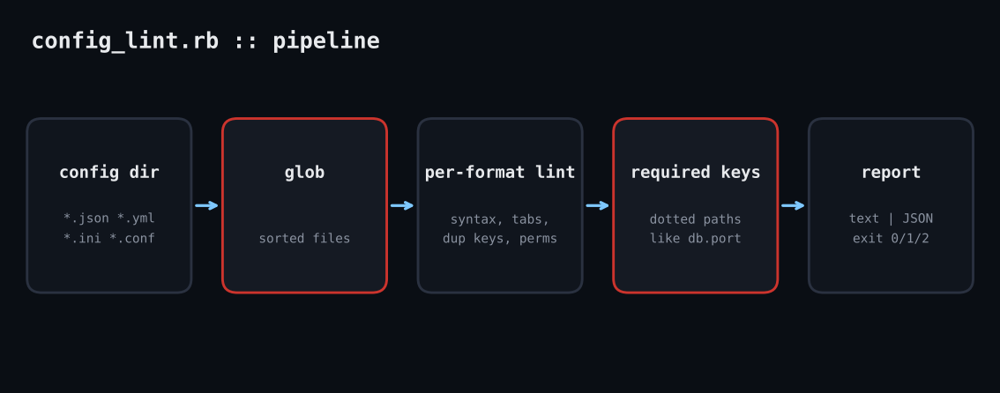

# config-lint

A trailing comma in JSON or a tab in YAML takes a service down at 2 a.m. This Ruby linter walks a directory, validates syntax, flags duplicate keys and world-writable files, and enforces required keys, with CI-friendly exit codes.

**Platform:** Linux / macOS / Windows  
**Script:** `config_lint.rb`



## The problem

Config errors are the cheapest outages to prevent and the most embarrassing to cause. Every format has its own failure: JSON rejects trailing commas, YAML forbids tab indentation, INI silently lets a duplicate key override the first. This script runs them all in one pass so it can sit in a pre-commit hook or CI stage.

## Prerequisites

Ruby 2.7+ (tested on 3.3.6). Only stdlib: `json`, `yaml`, `optparse`. Works on Linux, macOS and Windows.

## How it works

1. **Find files.** `Dir.glob` with a brace pattern collects `.json .yml .yaml .ini .conf .cfg` recursively and sorts them for stable output.
2. **Format-independent checks.** Trailing newline, mixed CRLF/LF, trailing whitespace per line, and world-writable permission bits via `File.stat(f).mode & 0o002`.
3. **Format-specific checks.** JSON and YAML are parsed (YAML with `safe_load`, so nothing executes); parse errors become high-severity issues. YAML tab indentation is caught before parsing for a clearer message. INI is scanned line by line to find duplicate keys per section and lines that are neither comments, sections nor key=value.
4. **Required keys.** `--require-keys db.host,db.port` walks dotted paths into the parsed data and reports any that are missing. Exit code 2 on any high finding makes CI fail.

## Example output

```text
$ ruby config_lint.rb conf/ --require-keys db.host,db.port
Checked 5 file(s)
[MEDIUM] conf/app.ini: line 3: duplicate key 'port' in [main] (first on line 2)
[HIGH] conf/app.ini: line 4: not a section, comment or key=value
[HIGH] conf/bad.json: invalid JSON: unexpected token at '{"db": {"host": "x",}}
[HIGH] conf/good.json: missing required key db.port
[MEDIUM] conf/ok.yml: world-writable (mode 666)
[LOW] conf/ok.yml: line 2: trailing whitespace
[HIGH] conf/tab.yaml: line 2: tab character used for indentation
[HIGH] conf/tab.yaml: invalid YAML: (<unknown>): found character that cannot start any token while scanning for the next token
(exit code 2)
```

## Troubleshooting

- Permission check is meaningless on Windows file systems; ignore that line there.
- YAML aliases are allowed; anchors to custom classes will raise and be reported as invalid.
- Large trees: add `--exclude` handling or narrow the glob.

## Extending

- Support TOML via the `toml-rb` gem.
- Validate against JSON Schema with `json_schemer`.
- Add a `--fix` mode for whitespace and newline issues.

## References

- [Ruby JSON docs](https://docs.ruby-lang.org/en/3.3/JSON.html)
- [Psych (YAML) safe_load](https://docs.ruby-lang.org/en/3.3/Psych.html)
- [YAML spec: indentation](https://yaml.org/spec/1.2.2/#61-indentation-spaces)

Part of [ruby-devops-toolkit](https://github.com/jjam3774/ruby-devops-toolkit). MIT licensed.
