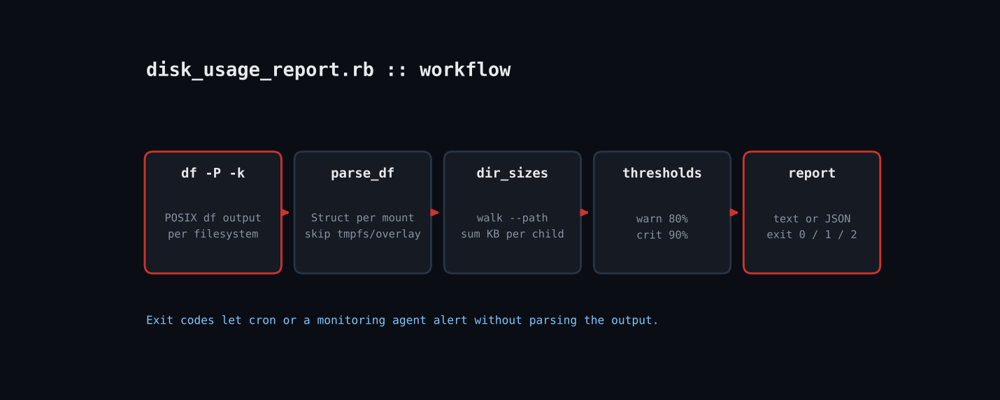

# A Disk Usage Report with Exit Codes for Monitoring

Disks fill up quietly. `df` tells you which mount is full but not `what` filled it, and parsing its output in shell gets fragile. In this tutorial you build a small Ruby tool that combines both answers and speaks the language monitoring systems understand: exit codes and JSON.



## Prerequisites

- Ruby 2.7+ (tested on 3.3.6); only the standard library is used (`optparse`, `json`, `open3`)
- A Linux or macOS host with POSIX `df`
- Read access to the directory you want to scan

## Usage

```
ruby disk_usage_report.rb --path /var --top 5 --warn 80 --crit 90
```

## How it works

### 1. Parse `df -P -k`

The `-P` flag forces POSIX output so each filesystem is exactly one line, even with long device names. `parse_df` splits each line into a `Filesystem` Struct. The mount point is re-joined from the remaining fields so paths with spaces survive.

### 2. Filter pseudo filesystems

tmpfs, overlay and similar devices are noise for capacity planning, so `read_df` rejects them along with zero-size mounts.

### 3. Find the heavy directories

`dir_sizes` sums file sizes under each immediate child of `--path`. It skips symlinks so a link loop cannot inflate the numbers, and rescues `SystemCallError` so one unreadable file does not abort the report.

### 4. Thresholds and exit codes

`level` maps a percentage to ok, warning or critical. The worst level across all filesystems becomes the process exit status (0, 1, 2), the same convention Nagios-style checks use.

### 5. Two output formats

Human text by default, `--json` for machines.

## Example output

```
MOUNT                       SIZE      USED  USE%  STATUS
/                       252.0 GB   12.8 GB   30%  OK
/opt/claude-code        308.8 MB  277.9 MB   92%  CRITICAL
/opt/env-runner          46.8 MB   30.3 MB   67%  OK
/mnt/sandboxing/model_tools_env/v1/python    4.0 KB    0.0 KB    0%  OK
/mnt/user-data/outputs 1024.0 TB    0.0 KB    0%  OK

Top 3 entries under /usr/lib:
      1.1 GB  /usr/lib/x86_64-linux-gnu
    386.0 MB  /usr/lib/llvm-18
    304.7 MB  /usr/lib/libreoffice
exit code: 2
```

## Troubleshooting

- **Totals look smaller than df:** the scan counts file contents only, not filesystem metadata, and skips unreadable files. Run with sudo to see everything.
- **Slow on huge trees:** point `--path` at a narrower directory such as `/var`.
- **macOS:** works, but the list of pseudo filesystems differs; extend the reject regex in `read_df`.

## Extending

- Append JSON results to a file and chart growth over time
- Send a Slack or email message when exit status is 2
- Add inode usage by parsing `df -i`
- Use `du -x` to stay on one filesystem during the scan

## References

- [Ruby Open3](https://docs.ruby-lang.org/en/3.3/Open3.html)
- [Ruby OptionParser](https://docs.ruby-lang.org/en/3.3/OptionParser.html)
- [POSIX df](https://pubs.opengroup.org/onlinepubs/9699919799/utilities/df.html)
