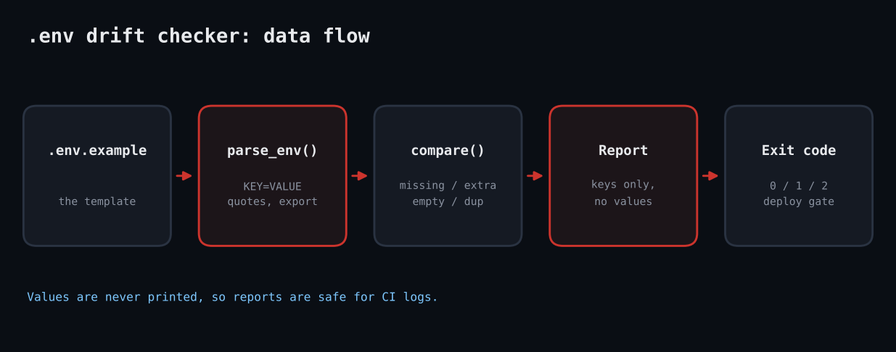

# Ruby .env Drift Checker

Environment files drift: someone adds `REDIS_URL` to the template but not to prod, a `SECRET_KEY=changeme` ships, a key is defined twice and the last one silently wins. This tool compares any number of env files with a template and reports exactly which keys are wrong, never the values.



## Prerequisites

Ruby 3.0+, stdlib only (json). Works identically on Linux, macOS and Windows.

## Usage

```
ruby env_drift_check.rb examples/.env.example examples/prod.env examples/staging.env
```

## How it works

1. **Parsing.** `parse_env` accepts `export KEY=val`, quoted values, trailing comments and blank lines, and records duplicate keys because dotenv loaders let the last one win.
2. **Comparing.** `compare` uses array set operations: template minus actual gives MISSING, the reverse gives EXTRA; EMPTY applies only where the template has a default; PLACEHOLDER matches values like changeme, your-..., xxx, TODO.
3. **Safety.** Only key names are printed. Reports are safe to paste into tickets or CI logs.
4. **Exit codes.** 2 if any file is missing keys, 1 for other drift, 0 clean; so it can gate a deploy pipeline.

## Example output

```
== examples/prod.env
  MISSING      REDIS_URL
  EXTRA        LEGACY_FLAG
  PLACEHOLDER  SECRET_KEY
  DUPLICATE    LOG_LEVEL
== examples/staging.env
  OK: matches template
exit=2
```

## Testing

Tested live in a Linux sandbox against example env files and a Minitest suite (6 assertions).

## Troubleshooting

- Multi-line quoted values are not supported; the parser is line-based.
- Variable interpolation (`${OTHER}`) is not expanded.
- If every key is reported MISSING, check the template path is the first argument.

## Extending

- Add a `--required` list so optional keys do not fail the build.
- Validate value formats (URL, integer, enum).
- Compare against live process environment in a container.

## References

- [Ruby String#scan / Regexp](https://docs.ruby-lang.org/en/3.3/Regexp.html)
- [The Twelve-Factor App: Config](https://12factor.net/config)
- [Ruby JSON](https://docs.ruby-lang.org/en/3.3/JSON.html)
