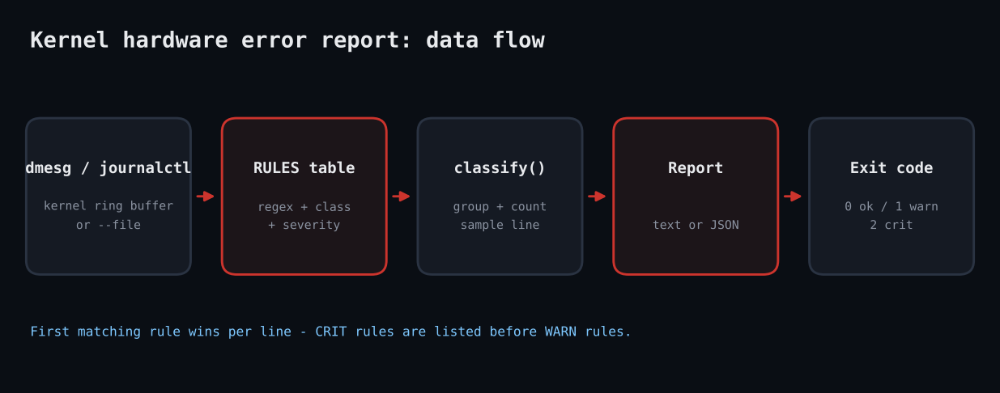

# Ruby Kernel Hardware Error Report

Hardware failures announce themselves in the kernel ring buffer long before an outage: corrected ECC errors on a DIMM, ATA link resets, `Buffer I/O error`, ext4 remounting read-only. Nobody greps dmesg daily. This tool reads the log (or a saved file), matches each line against a small rule table, groups results by class and severity, and tells you what to do.



## Prerequisites

Ruby 3.0+ (stdlib only: optparse, json, open3). Linux with `dmesg` or `journalctl -k`; reading the kernel log may need root (`kernel.dmesg_restrict`) or membership in `systemd-journal`.

## Usage

```
ruby kernel_hw_error_report.rb --file sample_dmesg.txt
```

## How it works

1. **The rule table.** `RULES` is an array of hashes: class, severity, regex and advice. Order matters: within a line the first matching rule wins, so CRIT rules come before WARN ones for the same class.
2. **Classifying.** `classify` walks every line, finds the first matching rule and aggregates into a `Finding` struct (count plus a sample line). Aggregating avoids a thousand identical lines flooding your terminal.
3. **Reading the log.** `read_log` tries `dmesg --ctime` then `journalctl -k -b`, or reads `--file` so you can analyse a captured log from another box.
4. **Exit codes.** 2 if any CRIT, 1 if only WARN, 0 clean (3 if no log is readable). That is all cron or Nagios needs.

## Example output

```
[CRIT] disk       x2   Block I/O failure: run smartctl and check cabling.
       e.g. [  301.020000] blk_update_request: I/O error, dev sda, sector 8421376
[CRIT] filesystem x2   Filesystem error: schedule fsck/xfs_repair.
       e.g. [  305.700000] EXT4-fs error (device sda1): ext4_find_entry:1455: inode #2
[WARN] disk       x1   ATA link trouble: reseat/replace SATA cable.
       e.g. [  300.510000] ata1.00: failed command: READ FPDMA QUEUED
[WARN] memory     x2   Corrected ECC errors: watch the rate; replace DIMM if climbing.
       e.g. [  120.220000] EDAC MC0: 1 CE memory read error on DIMM_A1
[WARN] pcie       x1   PCIe AER events: reseat card or update firmware.
       e.g. [  400.000000] pcieport 0000:00:1c.0: AER: Corrected error received
exit=2
```

## Testing

Tested live in a Linux sandbox against a hand-built dmesg fixture plus a Minitest suite (14 assertions). It was not run against genuinely failing hardware.

## Troubleshooting

- `dmesg: read kernel buffer failed: Operation not permitted`: run as root or use `journalctl -k` with the right group.
- A rotated ring buffer hides old errors; use `journalctl -k -b -1` output with `--file` for the previous boot.
- Regexes target common Linux wording; vendor drivers vary, so add rules to `RULES` for your hardware.

## Extending

- Send CRIT findings to Slack/webhook alerts.
- Track counts between runs to alert on a rising ECC rate rather than any ECC error.
- Add SMART data via `smartctl --json` for the failing device.

## References

- [Ruby Open3](https://docs.ruby-lang.org/en/3.3/Open3.html)
- [Linux kernel EDAC docs](https://docs.kernel.org/driver-api/edac.html)
- [dmesg(1) man page](https://man7.org/linux/man-pages/man1/dmesg.1.html)
