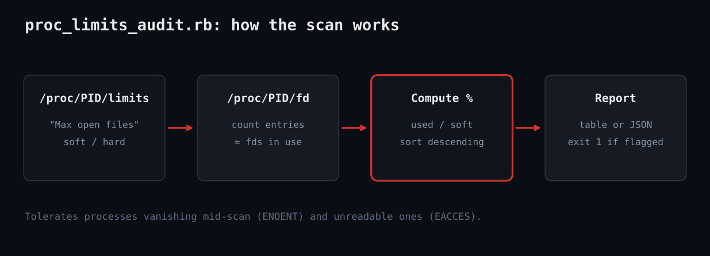

# Audit Linux Processes Near Their Open-File Limit in Ruby

Ruby script that flags Linux processes using a high share of their soft "Max open files" limit.



## Prerequisites

- Linux with procfs mounted at /proc
- Ruby 2.7 or newer (tested on 3.3); no gems required
- Run as root to see every process; as a normal user you only see your own

## Usage

```
ruby proc_limits_audit.rb --threshold 75
ruby proc_limits_audit.rb --json
sh test_proc_limits_audit.sh   # fake-procfs self test
```

## How it works

1. **Parse the limits file** - open_files_limit scans /proc/PID/limits for the line starting with "Max open files" and splits it into soft and hard values. The word "unlimited" is mapped to nil so we skip those processes.
2. **Count open descriptors** - Every entry in /proc/PID/fd is one open descriptor, so Dir.children(...).size is the usage figure.
3. **Tolerate races** - Processes exit while we scan. We rescue ENOENT, ESRCH and EACCES and move on rather than failing the whole run.
4. **Rank and report** - Rows are sorted by percent used. Anything at or above --threshold (default 80) is flagged; otherwise the top five are shown for context.
5. **Signal with the exit code** - Exit 1 if anything was flagged, 0 otherwise, which makes the script drop-in for cron, systemd timers or CI checks.

## Example output

```
Scanned 2 processes, 1 at or above 80% of soft NOFILE limit
PID     NAME                  USED    SOFT    PCT
100     nginx                  950    1024  92.8%
exit 1 (expected 1)
{
  "scanned": 2,
  "flagged": [
    {
      "pid": 100,
      "name": "nginx",
      "used": 950,
      "soft": 1024,
      "hard": 4096,
      "pct": 92.8
    }
  ]
```

## Troubleshooting

- Only a few processes scanned: run with sudo, otherwise other users' fd directories raise EACCES and are skipped.
- Percentages look low but the service fails: the limit may be raised at runtime or set by systemd LimitNOFILE=; compare against systemctl show.
- On containers the /proc you see is the container's; run on the host to audit all workloads.
- Tested here against a fake procfs and the live sandbox /proc.

## Extending

- Add a Max processes check from the same limits file.
- Push flagged rows to Slack or Prometheus (node_exporter textfile).
- Track growth over time to detect leaks, not just levels.
- Read /proc/PID/cmdline for friendlier names.

## References

- [proc(5) man page](https://man7.org/linux/man-pages/man5/proc.5.html)
- [Ruby Dir docs](https://docs.ruby-lang.org/en/3.3/Dir.html)
- [OptionParser](https://docs.ruby-lang.org/en/3.3/OptionParser.html)
