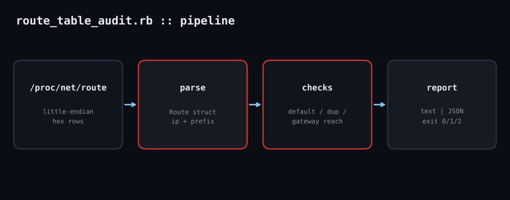

# route-table-audit

A box with two default routes at the same metric, or a gateway that is not on any connected subnet, fails in ways that look like flaky DNS or random timeouts. This pure-stdlib Ruby script reads /proc/net/route and tells you exactly what is wrong.

**Platform:** Linux  
**Script:** `route_table_audit.rb`



## The problem

Routing bugs are quiet. A second NIC brings up its own default route, a static route is typed with a gateway on the wrong subnet, or a VPN client leaves a duplicate behind. Nothing errors; some packets just go the wrong way. Checking by eye with `ip route` does not scale across a fleet. This script parses the kernel table directly and reports problems with a severity and an exit code you can wire into monitoring.

## Prerequisites

Ruby 2.7+ (tested on 3.3.6), Linux with `/proc/net/route`, no gems. The `--file` flag lets you test against a saved table on any OS.

## How it works

1. **Decode the hex.** `/proc/net/route` stores IPv4 addresses as little-endian hex (`010200C0` is 192.0.2.1). `[hex.to_i(16)].pack('L` reverses the byte order into a normal integer so subnet math works.
2. **Model a route.** A `Struct` holds interface, destination, gateway, flags, metric and mask. Helpers compute the prefix length (count of 1 bits), whether it is the default route, and whether the UP (0x1) and GATEWAY (0x2) flags are set.
3. **Run the checks.** Four rules: no live default route (high); several defaults sharing a metric (medium); duplicate destination/mask/metric rows (medium); and a gateway whose address does not fall inside a connected on-link subnet for the same interface (high). Down routes are reported as low.
4. **Report and exit.** Text or `--json` output. Exit 0 is clean, 1 warnings, 2 a high-severity finding, so cron or a monitoring agent can alert without parsing text.

## Example output

```text
$ ruby route_table_audit.rb --file bad_route
Routes parsed: 5
  0.0.0.0/0        eth0     via 192.168.1.1     metric 100
  0.0.0.0/0        wlan0    via 192.168.0.1     metric 100
  192.168.0.0/16   eth0     via on-link         metric 100
  192.168.0.0/16   eth0     via on-link         metric 100
  10.0.0.0/8       eth0     via 10.0.0.1        metric 0
[MEDIUM] 2 default routes share metric 100 (eth0, wlan0): path choice is ambiguous
[MEDIUM] Duplicate route 0.0.0.0/0 metric 100 on eth0, wlan0
[MEDIUM] Duplicate route 192.168.0.0/16 metric 100 on eth0, eth0
[HIGH] Gateway 192.168.0.1 for 0.0.0.0/0 is not inside any connected subnet on wlan0
[HIGH] Gateway 10.0.0.1 for 10.0.0.0/8 is not inside any connected subnet on eth0
(exit code 2)
```

## Troubleshooting

- Missing `/proc/net/route`: you are not on Linux. Use `--file` with a saved copy.
- Gateway flagged unreachable but traffic works: the gateway may be reachable through a more specific route on a different interface; extend the check to search all connected routes.
- Everything shows metric 0: normal on simple hosts; metrics matter only with multiple defaults.

## Extending

- Parse `/proc/net/ipv6_route` for IPv6.
- Diff against a stored known-good table and alert on change.
- Ship JSON output to Prometheus or your log pipeline.

## References

- [Linux kernel: /proc/net/route](https://www.kernel.org/doc/html/latest/networking/proc_net_tcp.html)
- [Ruby Array#pack](https://docs.ruby-lang.org/en/3.3/packed_data_rdoc.html)
- [ip-route(8)](https://man7.org/linux/man-pages/man8/ip-route.8.html)

Part of [ruby-devops-toolkit](https://github.com/jjam3774/ruby-devops-toolkit). MIT licensed.
