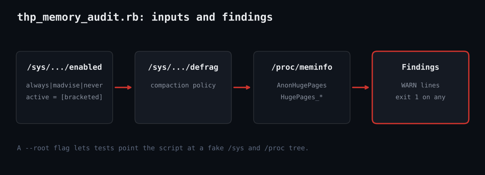

# Audit Transparent Huge Pages and Hugepage Usage in Ruby

Ruby script that audits Transparent Huge Pages mode, defrag policy and hugepage usage on Linux.



## Prerequisites

- Linux kernel with THP support (most distributions)
- Ruby 2.7 or newer (tested on 3.3); standard library only
- No root needed; the files are world-readable

## Usage

```
ruby thp_memory_audit.rb
ruby thp_memory_audit.rb --root /tmp/fake-root
sh test_thp_memory_audit.sh
```

## How it works

1. **Extract the active mode** - active_mode reads the file and uses raw[/\[(\w+)\]/, 1] to pull out the bracketed value, returning nil if the file does not exist (kernel without THP).
2. **Parse /proc/meminfo** - Each line is split on the first colon and converted with to_i, yielding kB values or page counts.
3. **Report the facts** - THP mode, defrag policy, AnonHugePages as a percent of RAM, and static hugepage totals are printed first.
4. **Apply the rules** - Mode always, defrag always, and fully free static hugepages each add a WARN line.
5. **Make it testable** - The --root option prefixes every path so the shell test can build a fake /sys and /proc tree.

## Example output

```
THP enabled : always
THP defrag  : madvise
AnonHugePages: 2048 MB of 16000 MB (12.8%)
Static HugePages: total=64 free=64 size=2048 kB
WARN: THP is "always": latency spikes from compaction are common on databases; prefer "madvise" or "never".
WARN: Static hugepages are reserved but completely unused: that memory is wasted.
exit 1 (expected 1)
THP enabled : madvise
THP defrag  : madvise
AnonHugePages: 0 MB of 16000 MB (0.0%)
Static HugePages: total=0 free=0 size=0 kB
OK: no THP concerns found.
exit 0 (expected)
```

## Troubleshooting

- "THP not exposed": containers or minimal kernels may hide sysfs; run on the host.
- Settings revert after reboot: persist via kernel cmdline transparent_hugepage=madvise or a systemd unit.
- "always" is not wrong for every workload; treat warnings as prompts to check your vendor guidance.
- Tested against a fake tree and the sandbox kernel.

## Extending

- Compare against a per-role policy file (databases vs. batch hosts).
- Per-process THP use from /proc/PID/smaps_rollup.
- Emit Prometheus metrics for fleet dashboards.
- Fix mode automatically behind a --apply flag.

## References

- [Kernel THP docs](https://docs.kernel.org/admin-guide/mm/transhuge.html)
- [proc_meminfo(5)](https://man7.org/linux/man-pages/man5/proc_meminfo.5.html)
- [Ruby Regexp](https://docs.ruby-lang.org/en/3.3/Regexp.html)
