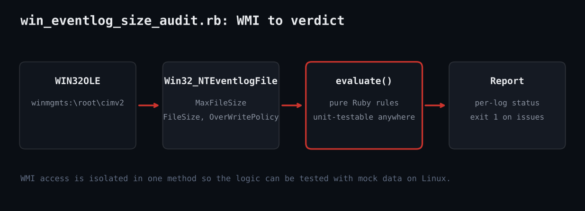

# Audit Windows Event Log Size and Retention with Ruby and WMI

Ruby script that audits Windows Event Log size, fullness and overwrite policy via WMI.



## Prerequisites

- Windows 10/11 or Server 2016+
- Ruby 3.x from RubyInstaller (win32ole included)
- Elevated prompt, especially to read the Security log
- Optional: --computer NAME for remote hosts with WMI/DCOM access

## Usage

```
ruby win_eventlog_size_audit.rb --min-mb 128 --full-pct 85
ruby test_win_eventlog_size_audit.rb   # mock test, any OS
```

## How it works

1. **Isolate WMI** - wmi_entries connects with WIN32OLE.connect("winmgmts:...") and converts COM objects into plain hashes, so nothing else depends on Windows.
2. **Define the rules** - evaluate compares MaxFileSize in MB to --min-mb, computes FileSize/MaxFileSize as a percent, and checks OverWritePolicy for "Never".
3. **Guard the entry point** - The $PROGRAM_NAME == __FILE__ check lets tests require the file without running WMI.
4. **Print and exit** - A fixed-width table shows each log with OK or the list of problems; exit code 1 signals findings to schedulers.
5. **Test with a mock** - The harness feeds four canned logs to evaluate and asserts which are flagged.

## Example output

```
LOG                     MAX(MB)    FULL  STATUS
Security                     20   25.0%  max size 20 MB < 64 MB (history is lost quickly)
System                      128   93.8%  94% full
Application                 256    3.9%  overwrite policy is Never: logging stops when the log fills
Setup                       256    0.4%  OK
ALL ASSERTIONS PASSED
```

## Troubleshooting

- Honest note: win32ole/WMI cannot run on Linux, so only the evaluate() logic was executed in the sandbox with mock data; the WMI call follows documented Win32_NTEventlogFile properties but was not run live.
- Access denied: run elevated; Security log needs admin.
- Modern channels (Microsoft-Windows-*/Operational) are not in Win32_NTEventlogFile; use wevtutil gl for those.
- Increase size with wevtutil sl Security /ms:536870912 or GPO.

## Extending

- Parse wevtutil gl output to cover operational channels.
- Loop over a host list for fleet-wide reports.
- Export CSV for auditors.
- Alert when file size grows faster than expected.

## References

- [Win32_NTEventlogFile (Microsoft)](https://learn.microsoft.com/en-us/previous-versions/windows/desktop/eventlogprov/win32-nteventlogfile)
- [Ruby WIN32OLE](https://docs.ruby-lang.org/en/3.3/WIN32OLE.html)
- [wevtutil reference](https://learn.microsoft.com/en-us/windows-server/administration/windows-commands/wevtutil)
