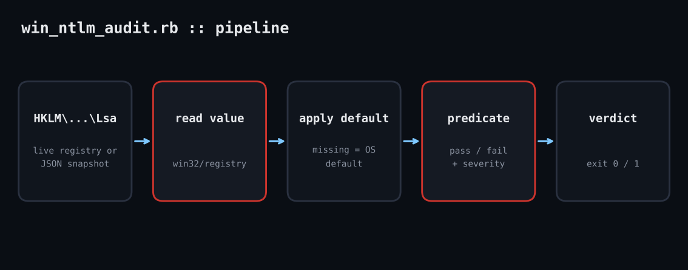

# win-ntlm-audit

NTLMv1 and LM fallbacks are still the easiest path to credential relay and cracking. This Ruby script reads five registry settings, applies the OS defaults for anything unset, and gives you a pass/fail verdict per control.

**Platform:** Windows  
**Script:** `win_ntlm_audit.rb`



## The problem

Windows keeps NTLM behaviour in a handful of registry values spread across `Lsa` and `Lsa\MSV1_0`. Group Policy can set them, but who verifies the result on a given host? When a value is absent the OS default applies, which is often the weak one. This script reads each value, substitutes the documented default when missing, and reports whether the effective setting meets a hardened baseline.

## Prerequisites

Windows with RubyInstaller (Ruby 3.x). `win32/registry` ships with Ruby on Windows. Read access to HKLM is enough; nothing is written. On Linux or macOS use `--snapshot` with a JSON export.

## How it works

1. **Declare the checks as data.** Each row is id, registry key, value name, description, a lambda predicate, expected text, severity and the default applied when unset. Adding a control is one line.
2. **Read the registry.** `Win32::Registry::HKEY_LOCAL_MACHINE.open(key) { |r| r[name] }` returns the value or raises if it is missing; the rescue turns that into `nil`, which is distinct from a real zero.
3. **Apply defaults and evaluate.** An unset value is replaced by its OS default before the predicate runs, so a missing `NtlmMinServerSec` correctly fails. The raw value and a note are kept so the report can say '(unset)'.
4. **Snapshot mode.** With `--snapshot file.json` the same logic runs from a JSON map of `"key|value"` to data. This makes the audit testable anywhere and lets you audit exported registry data offline.

## Example output

```text
$ ruby win_ntlm_audit.rb --snapshot snap_weak.json
FAIL  LAN Manager auth level         value=1            want >= 5 (NTLMv2 only, refuse LM/NTLM)  [high]
PASS  Do not store LM hash           value=1            want 1
FAIL  Min client session security    value=536870912    want 0x20080000 bits set  [medium]
FAIL  Min server session security    value=(unset)      want 0x20080000 bits set  [medium]
FAIL  Outgoing NTLM restriction      value=(unset)      want >= 1 (audit or deny)  [low]
NTLM posture: 4 setting(s) need attention
(exit code 1)
```

## Troubleshooting

- `Honest note:` win32/registry cannot run in the Linux sandbox where this was tested. The logic was verified through `--snapshot` against weak and hardened fixtures; the live read path is a three-line wrapper around the standard library.
- 'Access denied': run from an elevated prompt or check that the key ACL allows reads.
- Hardening `LmCompatibilityLevel` to 5 can break very old clients or NAS devices: audit first, enforce after.

## Extending

- Add the `RestrictNTLMInDomain` and audit-mode values.
- Query remote hosts through WinRM or WMI.
- Emit JSON to a SIEM on a schedule.

## References

- [Microsoft: LAN Manager authentication level](https://learn.microsoft.com/en-us/windows/security/threat-protection/security-policy-settings/network-security-lan-manager-authentication-level)
- [Ruby Win32::Registry](https://docs.ruby-lang.org/en/3.3/Win32/Registry.html)
- [Microsoft: Restrict NTLM](https://learn.microsoft.com/en-us/windows/security/threat-protection/security-policy-settings/network-security-restrict-ntlm-outgoing-ntlm-traffic-to-remote-servers)

Part of [ruby-devops-toolkit](https://github.com/jjam3774/ruby-devops-toolkit). MIT licensed.
