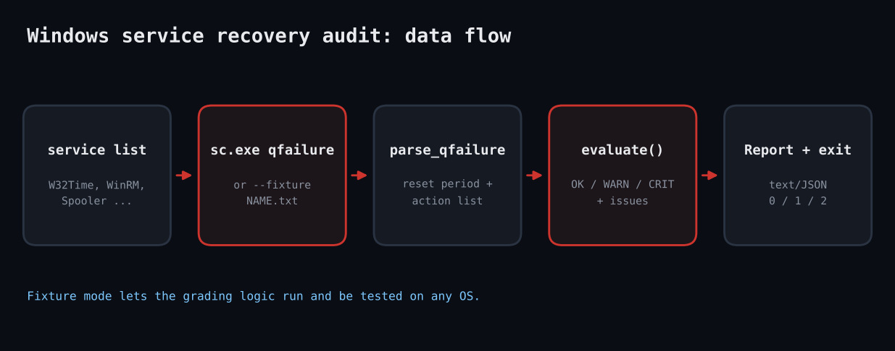

# Ruby Windows Service Recovery Audit

Windows lets each service define what happens on the first, second and subsequent failures: restart, run a program, reboot or nothing. Many services ship with nothing. When W32Time or WinRM crashes at 3 a.m. it simply stays dead. This script queries `sc.exe qfailure` for a list of services and grades the result.



## Prerequisites

Ruby 3.0+ on Windows (RubyInstaller) for live use; stdlib only (optparse, json, open3). No admin rights are normally needed to query. Linux works only in `--fixture` mode.

## Usage

```
ruby win_service_recovery_audit.rb --fixture fixtures --services Spooler,W32Time,WinRM,EventLog,Nope
```

## How it works

1. **Parsing sc output.** `parse_qfailure` uses regexes to pull `RESET_PERIOD` and each `ACTION -- Delay = N milliseconds` pair into a hash. INFINITE is mapped to a symbol.
2. **Grading.** `evaluate` marks CRIT when no actions exist, WARN for first-action NONE or REBOOT, restart delays under 1 second (crash-loop risk) or over five minutes, and a reset period that is missing or infinite.
3. **Querying.** `query` shells out to `sc.exe qfailure NAME` via Open3, or reads `NAME.txt` from `--fixture DIR` so the grading logic can be tested anywhere.
4. **Reporting.** One line per service with the action chain, then indented issues; `--json` for pipelines; exit 2 on CRIT, 1 on WARN.

## Example output

```
[OK  ] Spooler      RESTART(5s) > RESTART(5s) > NONE(0s)
[CRIT] W32Time      NONE(0s) > NONE(0s) > NONE(0s)
         - no recovery actions configured: a crash leaves the service down
[WARN] WinRM        RESTART(0s) > REBOOT(60s)
         - restart delay under 1s can cause a crash loop
[WARN] EventLog     RESTART(60s)
         - failure counter never resets (RESET_PERIOD infinite/missing)
[WARN] Nope         
         - service not found / query failed
exit=2
```

## Testing

sc.exe cannot execute on Linux, so parsing and grading were verified with fixtures shaped like real sc qfailure output and a Minitest suite (5 tests). Run it on a real Windows host before trusting it.

## Troubleshooting

- `service not found / query failed`: the service name is the short name (`sc query`), not the display name.
- Localized Windows may translate the `sc` labels; adjust the regexes.
- **Honest note:** sc.exe cannot run on Linux, so the parser was verified against fixtures shaped like real `sc qfailure` output, not a live Windows host.

## Extending

- Auto-fix with `sc failure NAME reset= 86400 actions= restart/5000/restart/5000//` behind a `--apply` flag.
- Read the service list from a YAML policy.
- Run across a fleet via WinRM.

## References

- [sc failure (Microsoft Learn)](https://learn.microsoft.com/en-us/windows-server/administration/windows-commands/sc-failure)
- [Ruby Open3](https://docs.ruby-lang.org/en/3.3/Open3.html)
- [RubyInstaller](https://rubyinstaller.org/)
